<div align="center">

<picture>
  <source media="(prefers-color-scheme: dark)" srcset="design/assets/kazzu-mark-dark.svg">
  <source media="(prefers-color-scheme: light)" srcset="design/assets/kazzu-mark-light.svg">
  
</picture>

# Kazzu

### Player de música em Rust + Slint


-blue?style=for-the-badge&labelColor=0d1117)


[**Baixar**](#baixar) · [**Recursos**](#recursos) · [**Contribuir**](#contribuir) · [**Suporte**](#suporte) · [**Aviso legal**](#aviso-legal)

</div>

> **Importante:** o Kazzu não é afiliado, endossado ou conectado ao YouTube, Google, Spotify, Tidal ou Qobuz. O YouTube Music é o provedor padrão, sem login, por conta e risco do usuário (termos de uso do serviço).

---

<div align="center">

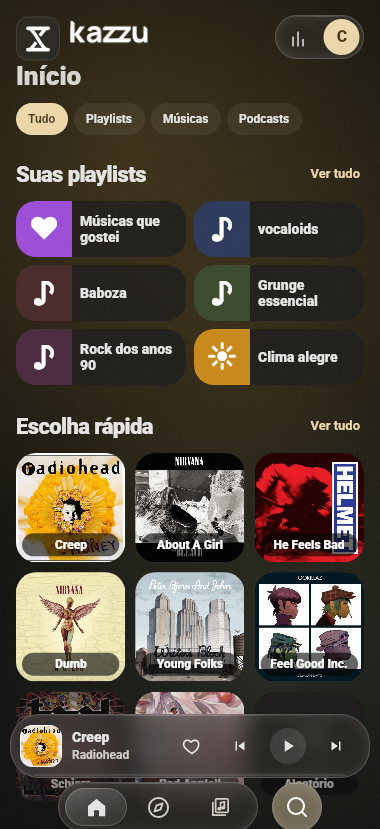

</div>

## Interface nova (mobile)

Capturas reais da UI Slint em **380×829 dp**, o tamanho lógico do aparelho de teste. Clique em qualquer miniatura para abrir a imagem completa.

| Início | Explorar | Biblioteca | Busca |
|:---:|:---:|:---:|:---:|
| [](design/v4/shots/ui-nova/01-home.png) | [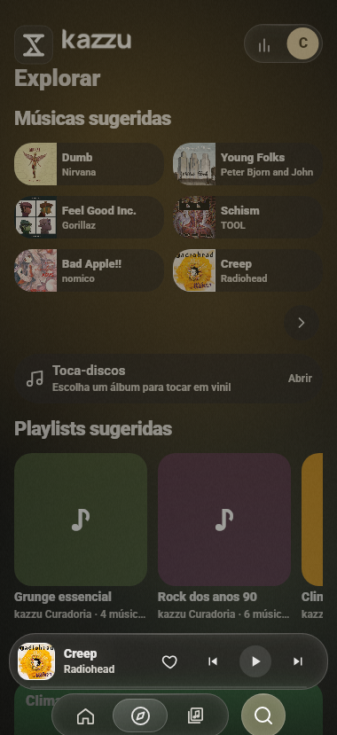](design/v4/shots/ui-nova/02-explore.png) | [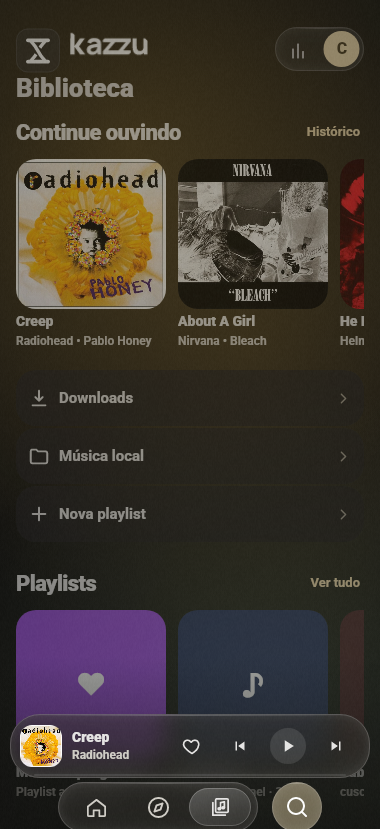](design/v4/shots/ui-nova/03-library.png) | [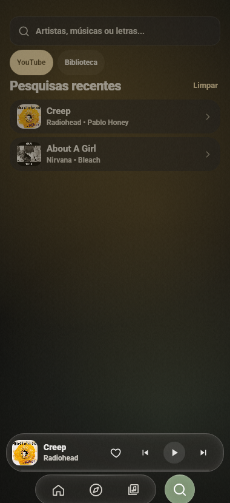](design/v4/shots/ui-nova/04-search.png) |

| Retrospectiva | Configurações | Detalhes | Aparência |
|:---:|:---:|:---:|:---:|
| [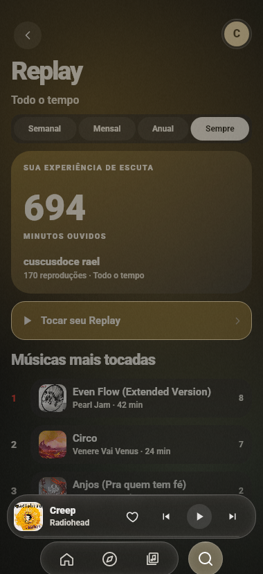](design/v4/shots/ui-nova/05-replay.png) | [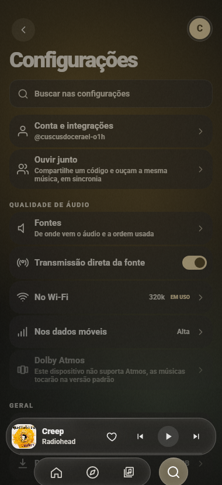](design/v4/shots/ui-nova/06-settings.png) | [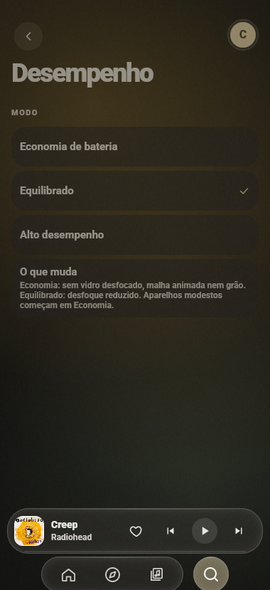](design/v4/shots/ui-nova/07-settings-page.png) | [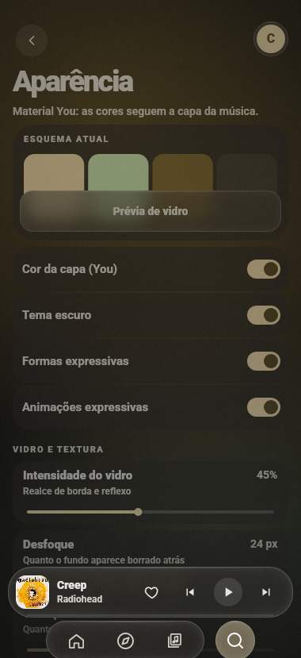](design/v4/shots/ui-nova/08-appearance.png) |

| Tema claro | Player | Fila | Mais opções | Letras |
|:---:|:---:|:---:|:---:|:---:|
| [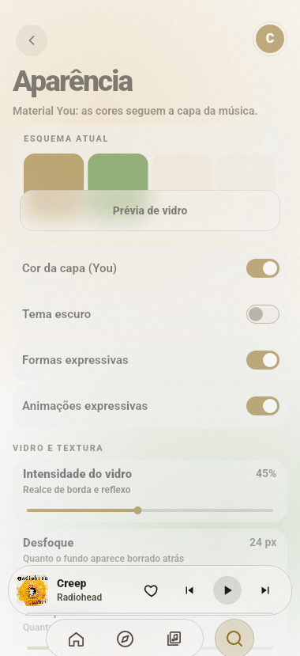](design/v4/shots/ui-nova/09-light.png) | [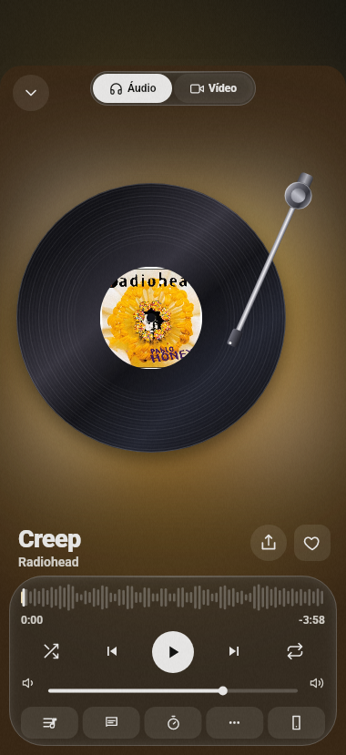](design/v4/shots/ui-nova/10-player.png) | [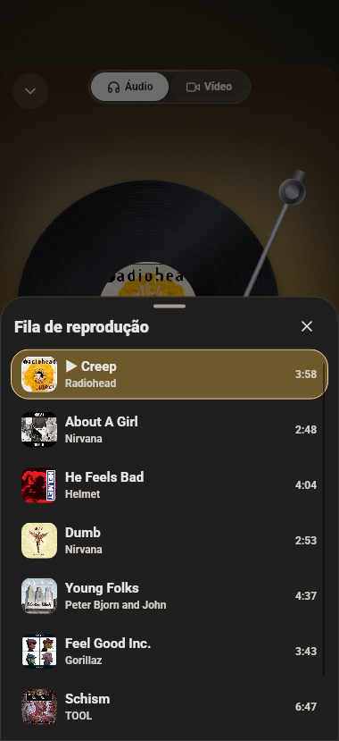](design/v4/shots/ui-nova/11-queue.png) | [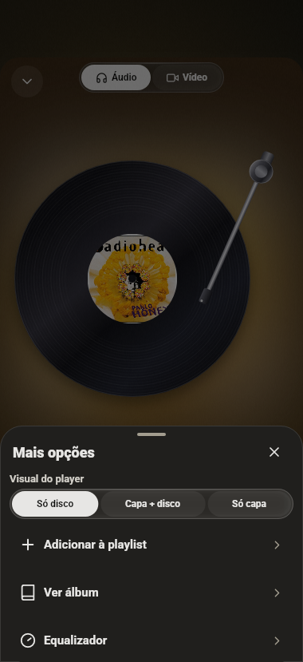](design/v4/shots/ui-nova/12-more.png) | [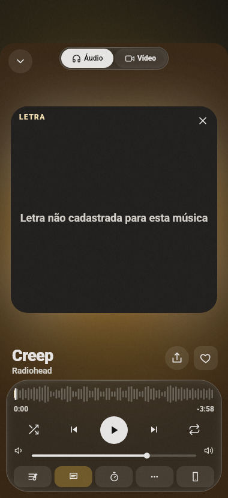](design/v4/shots/ui-nova/13-lyrics.png) |

---

# Recursos

#### Áudio

- **Bit-perfect de verdade** — o dispositivo abre na taxa e no número de canais nativos do arquivo; fontes de 16/24 bit chegam bit a bit iguais (há testes para FLAC 24/96 e WAV 16/44,1), com selo de "bit-perfect" no player.
- **Gapless e seek preciso** — junção sem lacuna entre faixas e seek exato ao frame, inclusive em streams remotos.
- **Qualidade original** — sem resample, normalização ou equalizador no caminho padrão; resample só se o dispositivo recusar a taxa, DSP é opt-in e bypass = bit-perfect.
- **Formatos** — FLAC, WAV/AIFF/CAF (PCM), ALAC, MP3 (e MP1/MP2), AAC (M4A/MP4), Vorbis, Opus (Ogg/WebM) e ADPCM; MP4 fragmentado (DASH) incluso.
- **Fila completa** — shuffle (Fisher–Yates), repetir um/tudo, tocar em seguida, mover, remover e pular faixas que falham.
- **Streaming HTTP** — requisições Range com retomada e backoff, pré-buffer gapless, renovação de URL vencida na posição e cache em disco (LRU de 256 MiB, base do modo offline).
- **Sem telemetria** — nenhuma chamada de rede além do que o usuário acionou (e a rodada de abertura do Início).

#### Interface

- **Glassmorphism de verdade** — painéis translúcidos com desfoque real do fundo (backdrop-blur), borda de luz, brilho especular e sombra suave, com alternativa acessível "reduzir transparência".
- **Mobile-first** — projetado a partir de 360–412 px, com doca de vidro, áreas seguras e alvos de toque ≥ 48 px.
- **Desktop** — faixa larga com barra lateral sólida e player em duas colunas sobre a capa muito desfocada.
- **Tema claro e escuro**, player sempre escuro e acento fixo "Brasa".
- **Acessibilidade** — contraste medido em captura real (WCAG 2.2 AA), redução de movimento, navegação por teclado e botão Voltar no Android.
- **Fundo derivado da capa** — o palco e o vidro do player são tinted pela capa (backdrop 192×464, desfoque σ3).

#### Biblioteca

- **Biblioteca local** — scan incremental (só relê o que mudou), tags via `lofty`, SQLite com FTS5, álbuns agrupados por (título, artista) e capas embutidas ou de pasta, com miniatura e versão pré-desfocada.
- **Playlists e curtidas locais** — playlists mistas, com faixas do YouTube Music guardadas por referência (banco v2).
- **Histórico local** — nunca sai do aparelho; servirá à retrospectiva.

#### YouTube Music (provedor padrão)

- **Sem login e sem configuração** — Início, busca, reprodução, rádio e capas funcionam no primeiro uso.
- **Fila sob demanda** — o motor recebe só a faixa pedida e 2 à frente; ao fim da fila, "Continuar com músicas parecidas" pede o rádio.
- **Resiliência** — URL vencida é renovada e retomada na posição; queda de rede mostra "Tentar de novo" e a fila se recupera sozinha.
- **Privacidade** — sem identificador de usuário, sem prefetch, sem sondagem em segundo plano; `--no-youtube` desliga tudo.

#### Android

- **APK sem Android Studio e sem Gradle** — `scripts/build-apk.sh` usa só ferramentas oficiais do SDK/NDK (`aapt2`, `zipalign`, `apksigner`), backend nativo **AAudio** e Skia com `backdrop-blur`.
- **Alpha** — compila, assina, instala e abre (verificado em emulador Android 14); **não** testado em aparelho físico. Reprodução em segundo plano e notificação de mídia ficam para uma próxima etapa.
- `minSdk` 26 (Android 8+), ABI `arm64-v8a` publicada; `x86_64` só para emulador.

#### Em breve

- **Etapa 3 — Som:** equalizador avançado, integração com Discord, MPRIS/controles de mídia.
- **Etapa 4 — Social/sync:** sincronização e "ouvir junto" por LAN/P2P (mDNS, QUIC), offline completo.
- **Etapa 5 — Extras:** retrospectiva estilo Spotify e busca por som ambiente.

---

# Baixar

Não há builds públicos por enquanto — o repositório é privado. Para compilar a partir do fonte:

```sh
cargo run -p kazzu-app --release -- --demo-library target/fixtures/kazzu-demo
cargo run -p kazzu-app --release                                 # YouTube Music + sua biblioteca
cargo run -p kazzu-app --release -- --no-youtube                 # só arquivos locais, zero rede
cargo test --workspace
```

Veja `crates/kazzu-app/README.md` para as flags (`--null-audio`, `--renderer`, `--snapshot`).

**Android:** `scripts/build-apk.sh` gera e assina o APK (requer SDK/NDK r30; passo a passo em [`docs/ANDROID.md`](docs/ANDROID.md)). O CI (`.github/workflows/android.yml`) publica o APK nas releases de tag quando os segredos de assinatura estão cadastrados.

---

# Contribuir

Contribuições são bem-vindas! Cada etapa termina com `cargo build`, `cargo clippy -- -D warnings` e `cargo test` verdes. Leia o brief e as regras antes de abrir um Pull Request.

[**Brief e regras**](docs/BRIEF.md) · [**Arquitetura**](docs/ARCHITECTURE.md) · [**Dependências**](docs/DEPENDENCIES.md) · [**Notas da UI**](docs/UI_NOTES.md) · [**Android**](docs/ANDROID.md)

### Obrigado a todos os contribuidores

[](https://github.com/cuscusdc/kazzu/graphs/contributors)

---

# Suporte

O Kazzu é gratuito e sempre será — tudo o que ele usa e o que é preciso para publicá-lo é open source e sem custo (regra "100% grátis" do projeto). Não há plano pago, chave de API paga nem servidor pago.

- **Dúvidas e problemas:** abra uma [issue](https://github.com/cuscusdc/kazzu/issues).
- **Documentação:** comece por [`docs/BRIEF.md`](docs/BRIEF.md) e [`docs/ARCHITECTURE.md`](docs/ARCHITECTURE.md).

---

# Aviso legal

O Kazzu é um cliente de música independente, feito pela comunidade. **Não** é associado ao Google LLC, YouTube, YouTube Music, Spotify, Tidal, Qobuz ou a qualquer de suas controladoras.

- **Sem hospedagem de mídia:** o Kazzu não hospeda, envia ou armazena músicas protegidas. Ele opera estritamente como interface para arquivos locais do aparelho ou streaming direto de APIs públicas/ autenticadas pelo usuário.
- **Uso do YouTube Music:** o provedor padrão acessa o YouTube Music sem login; o usuário é o único responsável por alinhar seu uso aos termos de serviço do YouTube e à legislação local de direitos autorais.
- **Sem garantia de bypass:** o Kazzu não garante burla permanente de condições comerciais de plataformas de terceiros.
- **Copyleft:** a licença pretendida é a GPL-3.0 (ver abaixo); distribuições devem vir com o código-fonte correspondente sob a mesma licença.

---

# Licença

O Kazzu pretende ser software livre sob a **GNU General Public License v3.0 (GPLv3)** — a licença que o Slint exige no tier gratuito, o que também libera as crates GPL necessárias. A decisão final é do autor (reversível enquanto o repositório for privado); o registro completo de dependências e licenças está em [`docs/DEPENDENCIES.md`](docs/DEPENDENCIES.md).