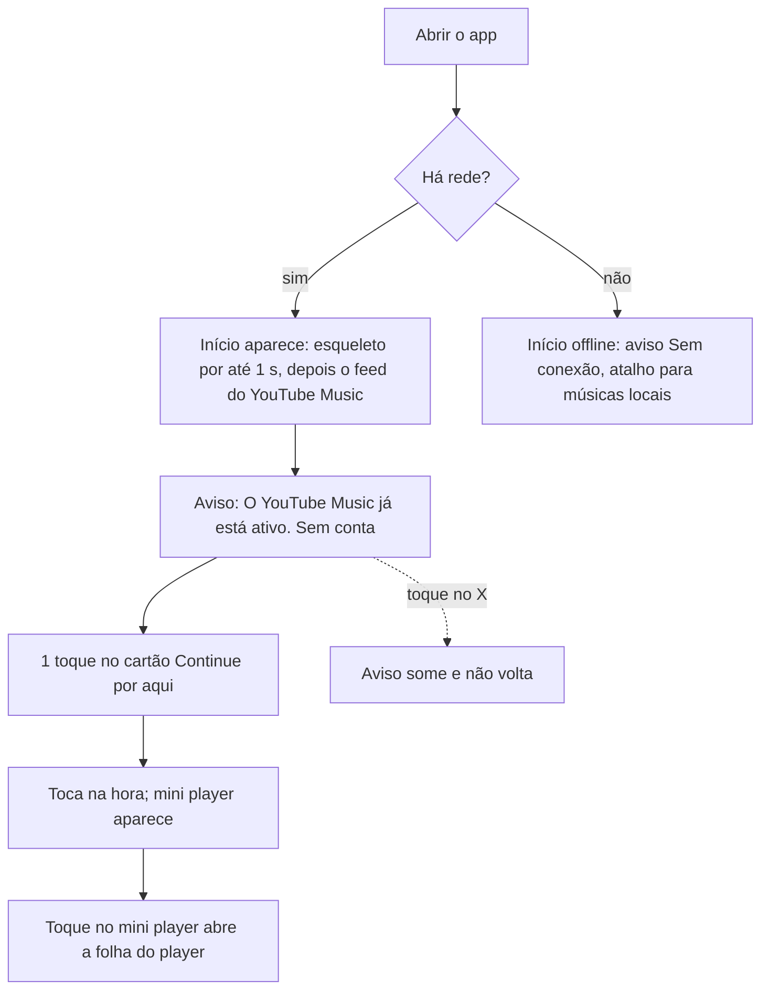
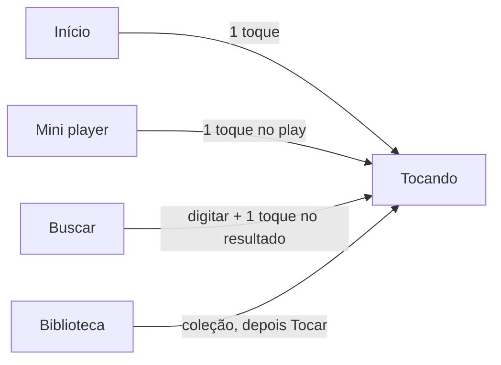
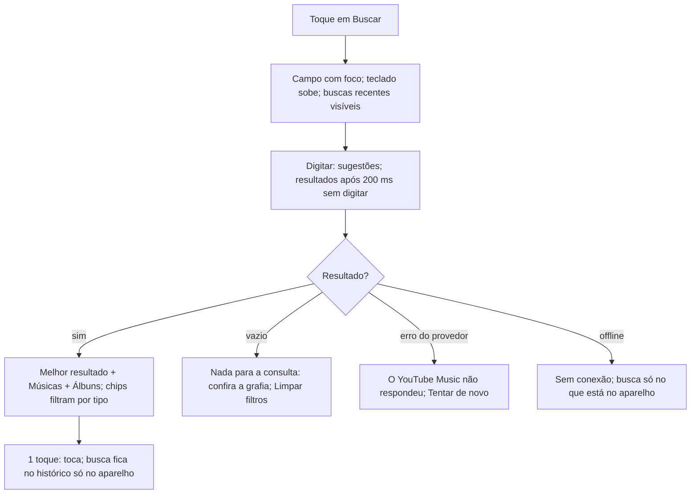
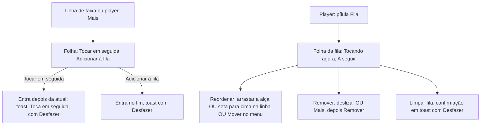
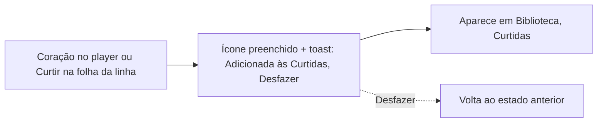
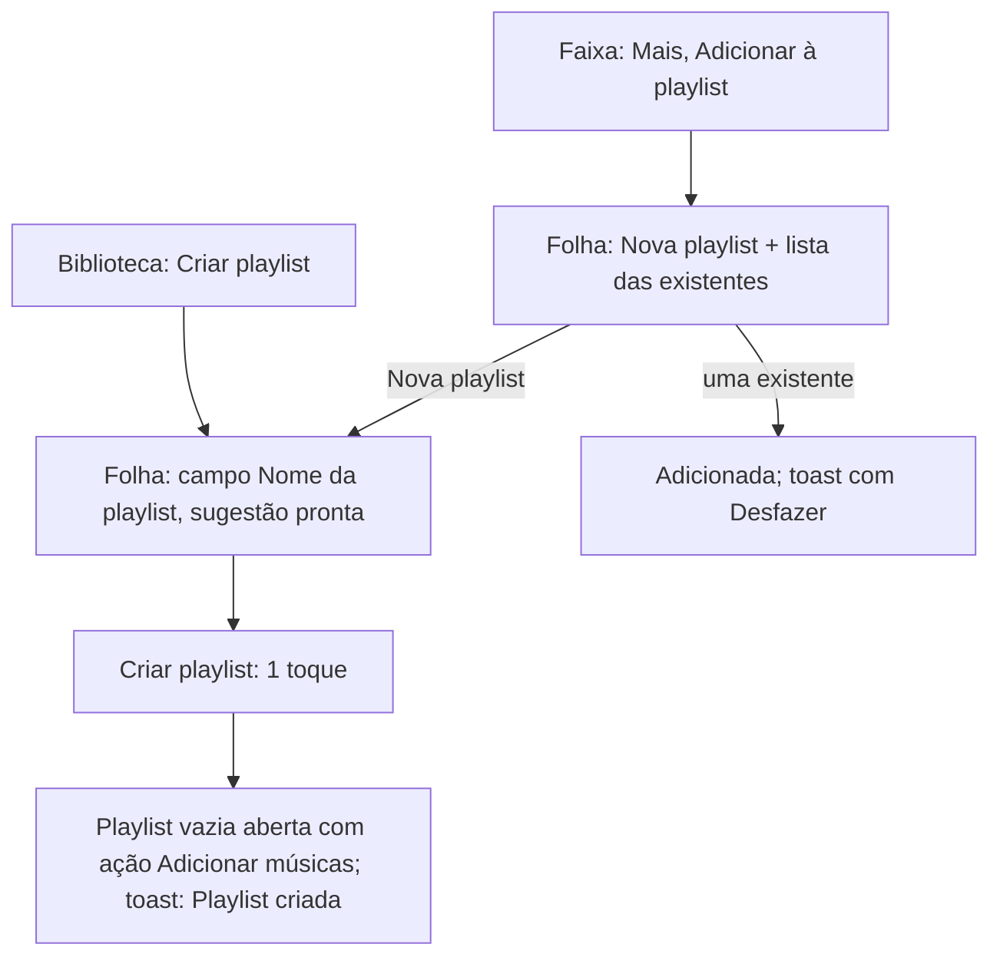
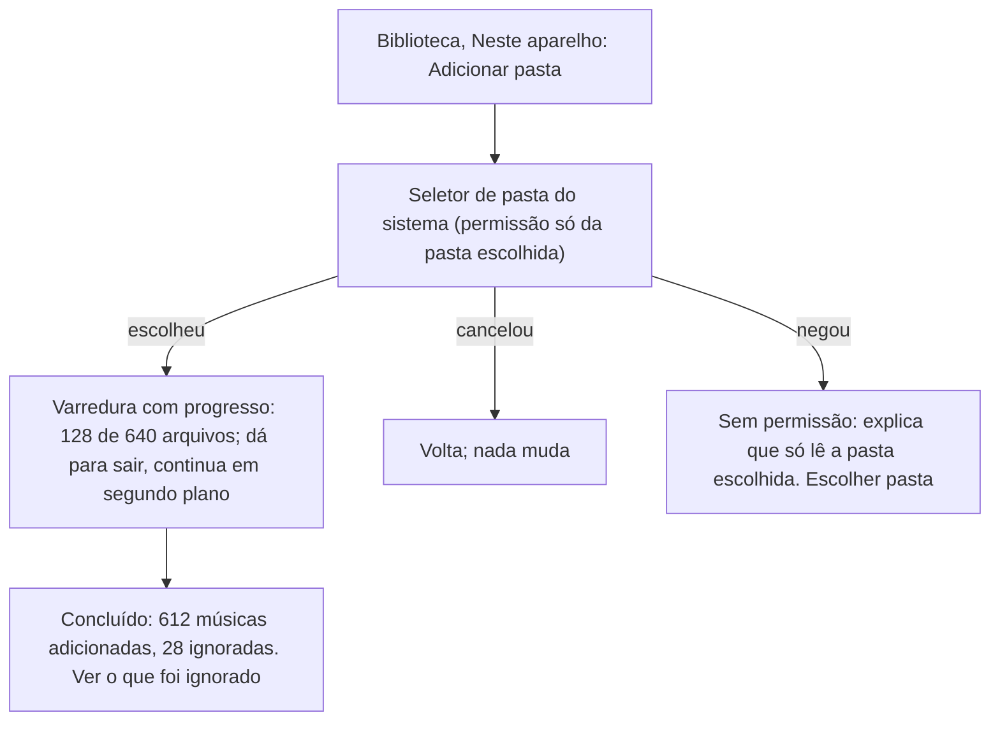
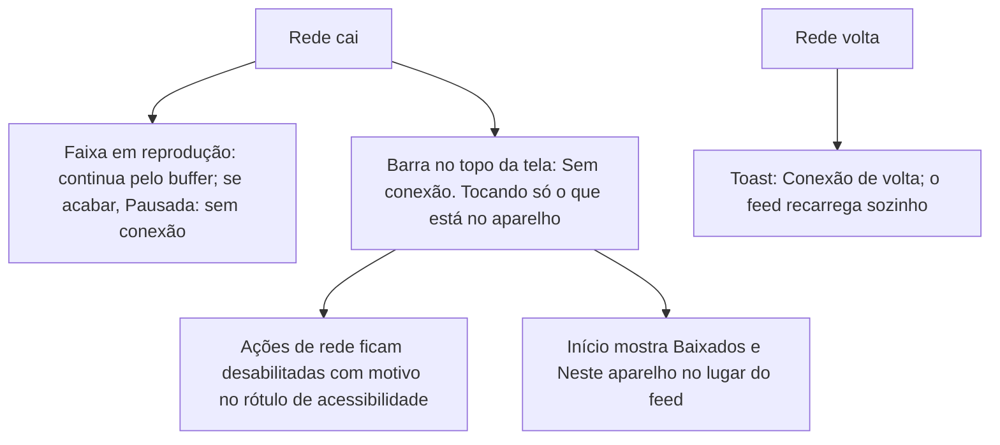
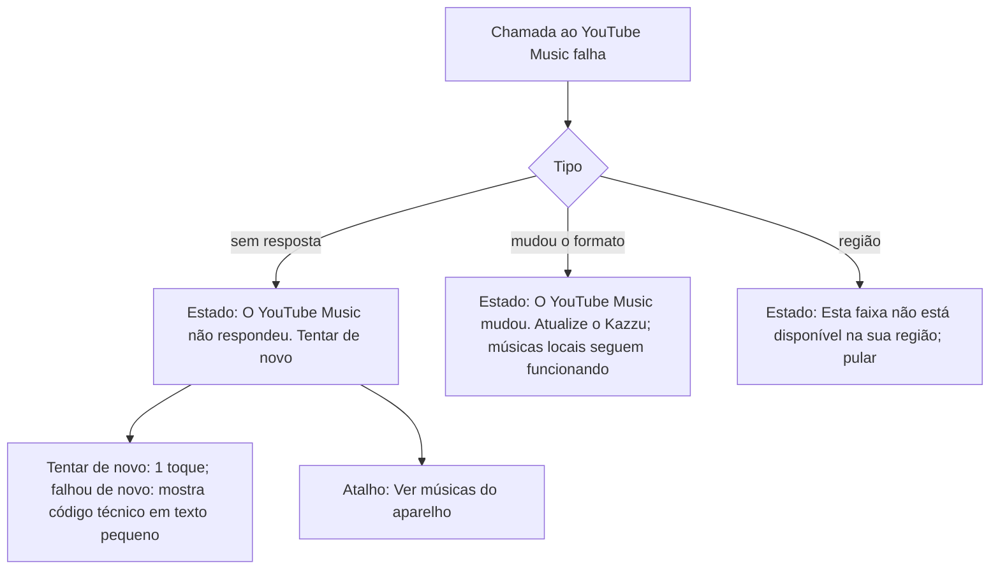

# Kazzu — planejamento de UX (v2, mobile-first)

Versão 0.2 · 2026-11-22 · pt-BR. Substitui as decisões de UX da v1 (que partiu do desktop). Companheiros: `design/DESIGN.md` (UI e vidro), `design/SLINT_SPEC.md` (implementação), `design/prototypes/index.html` (telas navegáveis), `design/ux/contrast-report.md` (contraste medido).

**Como ler.** A parte 1 diz *o que* e *por quê*; as partes 2 a 7 são o projeto de experiência (quem usa, estrutura, navegação, fluxos, estados); 8 a 11 são qualidade (gestos, acessibilidade, desempenho, responsivo); 12 e 13 dizem como validar **sem telemetria** e em que ordem construir. Tudo o que é número de meta é **proposta a medir**, não fato medido. Onde um dado depende do autor, está marcado em *Decisões para o autor* (parte 14).

## 0. Resumo em dez linhas

1. O Kazzu nasce no **celular** (Android primeiro), com o **polegar** como régua. Tablet e desktop expandem o mesmo desenho.
2. **YouTube Music já ativo, sem login e sem configuração**: o primeiro som sai em **no máximo 2 toques** a partir da abertura do app.
3. Quatro destinos, nunca mais: **Início, Explorar, Biblioteca** na barra inferior e **Buscar** como botão circular próprio (decisão do autor: sem barra de busca fixa no topo).
4. **Mini player persistente** sobre a barra; um toque ou arrastar para cima abre a **folha do player**; arrastar para baixo, o botão "Fechar" ou o gesto Voltar fecham.
5. Toda ação importante fica **na metade de baixo** da tela (zona do polegar); o topo guarda só identidade e ajustes.
6. **Nenhum gesto é obrigatório**: arrastar, deslizar e segurar têm alternativa por toque (WCAG 2.5.7) e por leitor de tela.
7. Todo estado existe e foi desenhado: vazio, carregando (esqueleto), erro com ação, offline, sem permissão.
8. Alvos de **48 dp**, contraste **AA medido em captura real**, **TalkBack** completo, **reduzir transparência** e **reduzir movimento** de verdade.
9. **Sem telemetria**: a validação é feita com 5 pessoas em sessões moderadas, percurso cognitivo, checklist heurístico e critérios de aceite mensuráveis *localmente*.
10. Backlog priorizado em MoSCoW (parte 13), em etapas pequenas e verificáveis.

---

## 1. Visão e princípios

> **Tocar é o trabalho; o resto é caminho.** Quem abre o Kazzu quer som, não configuração.

### 1.1 Princípios de produto (testáveis)

| # | Princípio | Como se verifica |
|---|---|---|
| P1 | **Som primeiro.** O caminho mais curto até música tocando nunca passa por login, tutorial ou permissão que não seja do que o usuário acabou de pedir. | Roteiro T1: primeiro som em ≤ 2 toques e sem tela intermediária. |
| P2 | **Polegar primeiro.** Controles frequentes ficam abaixo do meio da tela; o topo não tem ação urgente. | Revisão de cada tela: mapa de zonas (parte 5.3). |
| P3 | **Reconhecer em vez de lembrar.** Rótulos de texto em toda ação não óbvia; ícone sozinho só para o que é universal (play, próxima, fechar). | Checklist heurístico H6. |
| P4 | **O sistema fala o que está acontecendo.** Fonte (YouTube Music, neste aparelho), qualidade (`OPUS 160`), rede, erro: sempre visíveis onde importam, nunca escondidos. | Teste T6; cada estado tem texto. |
| P5 | **Controle e saída.** Tudo é desfazível ou cancelável; nenhum beco sem saída. | Walkthrough: toda tela tem caminho de volta. |
| P6 | **Acessível por construção.** Não é uma camada final; os gestos, as cores e o vidro nascem com alternativa. | Parte 9; critérios de aceite AC-03 a AC-07. |
| P7 | **Privacidade visível.** "Sem telemetria" é dito, mostrado e **não tem chave para desligar**. | Ajustes › Privacidade; AC-10. |
| P8 | **Quieto.** Sem notificações promocionais, sem pesquisas dentro do app, sem selo "novo", sem loops de animação. | Revisão de tela; AC-09. |

### 1.2 O que o vidro faz pelo UX (e quando ele sai)

O vidro não é enfeite: **separa camadas de profundidade** (conteúdo, barras flutuantes, folhas), **mostra continuidade** (a lista segue existindo, desfocada, atrás da barra) e **liga o app à capa** que está tocando. Por isso: vidro só em superfícies que *flutuam*; listas ficam planas; e tudo que é vidro tem alternativa **sólida** (Reduzir transparência) que preserva a hierarquia.

---

## 2. Personas e jobs-to-be-done

Personas **fictícias**, construídas a partir do mapa mental do autor e da pesquisa em `docs/research/`. São hipóteses a testar na parte 12, não retratos de dados.

| Persona | Contexto | Quer | Não tolera |
|---|---|---|---|
| **Marina, 27, ouvinte casual no ônibus.** Celular Android médio, uma mão, rede instável. | 40 minutos de trajeto, em pé, no sol. | Dar play numa coisa boa sem pensar; pausar e retomar com uma mão; que continue quando a rede cai. | Cadastro, tela cheia de opções, texto pequeno, botão no alto da tela. |
| **Davi, 38, entusiasta de hi-fi.** Fone com DAC, arquivos FLAC, olha a taxa de bits. | Sofá, tela maior, sessões longas. | Saber exatamente o que está tocando (codec, taxa), áudio sem processamento, equalizador desligável. | Normalização ou reamostragem escondidas, "qualidade melhorada" sem explicar. |
| **Beatriz, 45, biblioteca local.** Anos de arquivos em pastas, sem assinatura. | Quer tudo no celular e no computador. | Apontar uma pasta e ver o acervo organizado; tocar offline; capas e tags corretas. | Pedir permissão demais, reorganizar arquivos, perder playlists. |
| **Caio e Lu, 22, dividem com amigos.** | Festa, carro, casa. | Ouvir juntos; um aparelho controlar o do outro (etapa 4). | Atrito para convidar; exigir conta do amigo. |

### 2.1 Jobs-to-be-done

Formato: *Quando [situação], quero [ação], para [resultado].*

| ID | Job | Persona | Tela principal | Etapa |
|---|---|---|---|---|
| J1 | Quando abro o app com pressa, quero ouvir algo bom agora, para não gastar a atenção que não tenho. | Marina | Início | 2 |
| J2 | Quando lembro de uma música, quero achá-la e tocá-la em poucos toques, para não perder o momento. | Marina, Caio | Buscar | 2 |
| J3 | Quando estou no ônibus sem rede, quero que o que já está no aparelho continue tocando, para a viagem não quebrar. | Marina, Beatriz | Biblioteca, Início | 1 |
| J4 | Quando coloco um disco para ouvir de verdade, quero ver o formato e a taxa e saber que nada foi alterado, para confiar no som. | Davi | Player | 1 |
| J5 | Quando tenho arquivos no aparelho, quero apontar uma pasta e ver tudo organizado, para tocar sem assinatura. | Beatriz | Biblioteca | 1 |
| J6 | Quando gosto de uma música, quero curtir com um toque e achá-la depois, para montar meu acervo sem esforço. | todos | Player, linha | 1 |
| J7 | Quando quero um clima (foco, estrada), quero escolher um humor, para não montar fila à mão. | Marina | Explorar | 2 |
| J8 | Quando mexo na fila, quero ver o que vem a seguir e reordenar, para controlar a noite. | Caio e Lu | Fila | 1 |
| J9 | Quando preciso de ajuda de acessibilidade (texto maior, menos transparência), quero achar isso rápido, para usar sem esforço. | todos | Ajustes › Aparência | 1 |
| J10 | Quando divido a escuta, quero que outro aparelho controle ou toque junto, para ouvir em grupo. | Caio e Lu | Player › Saída | 4 |

---

## 3. Análise heurística e competitiva

### 3.1 O que foi analisado

As cinco capturas de tela do autor em `.refs/images/` (Bitchord: início e player; Umihi Music: biblioteca; Intertune: início e player). O objetivo é extrair **convenções** (o que o usuário de player de música já sabe) e **falhas** (o que não repetir). **Nenhuma arte, ícone, texto ou layout exato é reutilizado**; o desenho do Kazzu é próprio.

### 3.2 Avaliação contra as 10 heurísticas de Nielsen

Legenda: **+** acerta, **−** falha ou arrisca, **·** neutro. Observações vêm das capturas, não de uso real.

| Heurística | Bitchord | Umihi | Intertune | O que o Kazzu faz |
|---|---|---|---|---|
| **H1 Visibilidade do estado** | **+** mini player mostra faixa e progresso fino | **−** coleção "Baixado, 0 músicas" não diz o que fazer | **+** mostra motivo de cada sugestão ("Porque você tocou…") | Fonte, qualidade e rede sempre visíveis; vazio sempre diz a próxima ação |
| **H2 Linguagem do usuário** | **−** misto de inglês e português | **+** rótulos simples ("Criar playlist") | **+** pt-BR claro | pt-BR, verbo + objeto, sem jargão |
| **H3 Controle e liberdade** | **+** player se dissolve na capa, sai por gesto | **−** sem indício de como desfazer | **+** cartão de aviso tem "dispensar" | Desfazer em toda ação destrutiva; fechar por botão **e** gesto |
| **H4 Consistência e padrões** | **+** pílula de navegação + busca circular (convenção atual) | **+** barra de 3 destinos | **−** barra de busca no topo *e* ícone de música na barra: dois caminhos para o mesmo lugar | Um caminho por destino; busca é só o botão circular |
| **H5 Prevenção de erros** | · | · | · | Confirmação só no irreversível; ações de rede desabilitadas offline com motivo |
| **H6 Reconhecer em vez de lembrar** | **−** ícones de letra, saída e fila sem rótulo | **+** cartões com texto | **+** pílulas de ação com rótulo ("Este celular") | Ações secundárias do player com rótulo de texto |
| **H7 Flexibilidade e eficiência** | **+** carrossel de destaques | **−** "Criar playlist" fixo no canto superior direito, longe do polegar | **+** filtros rápidos (chips) | Atalhos por chips; ações primárias embaixo |
| **H8 Estética e minimalismo** | **+** uma ideia por tela | **−** cartões escuros idênticos, sem hierarquia | **−** painel de pesquisa no meio do caminho do conteúdo | Uma ideia por tela; vidro marca camadas |
| **H9 Ajudar no erro** | · | · | · | Erro diz o que houve, por quê e a ação; código técnico em texto pequeno |
| **H10 Ajuda e documentação** | · | · | **−** cartão de pesquisa de opinião dentro do app | **Sem** pesquisas dentro do app (princípio P8); ajuda contextual curta |

**Achados que viram regra de projeto**

- Contraste: textos secundários cinza sobre fundo escuro, em duas das capturas, parecem abaixo do mínimo (por exemplo "Ver tudo" no rodapé do Bitchord). **Regra:** texto secundário em ≥ 4,5:1 medido no vidro, não calculado no fundo liso.
- Ícones sem rótulo no player exigem aprendizado. **Regra:** pílulas com texto sob o ícone.
- Ação de criar no canto superior direito exige esticar o polegar. **Regra:** ação de criação fica na faixa inferior ou é um item no fim da lista.
- A pesquisa de opinião dentro de um app é o oposto de "sem telemetria". **Regra:** zero pesquisa embutida.

### 3.3 Convenções adotadas (e de onde vêm)

| Convenção | Origem | Aplicação |
|---|---|---|
| Barra de navegação inferior com 3 a 5 destinos | Material 3 (Navigation bar), HIG (Tab bar) | 3 destinos + busca circular |
| Mini player persistente sobre a barra | Prática comum de players | Pílula de vidro nível 2 |
| Folha que sobe do mini player | Material 3 (Bottom sheet), HIG (Sheet) | Folha do player e fila |
| Carrossel de destaques + listas | Prática comum de players | "Continue por aqui", "Mixes" |
| Chips de filtro | Material 3 (Chips) | Seções do Início, filtros de busca |
| Alvo mínimo 48 dp | Material 3 / Android; HIG pede 44 pt | 48 dp em todo o app |
| Lei de Fitts, zona do polegar | Laws of UX | Ações embaixo, alvos grandes |
| Lei de Hick, divulgação progressiva | Laws of UX | Menu "mais" abre folha com ≤ 7 itens; ajustes em grupos |
| Lei de Jakob | Laws of UX | Gestos e posições que o usuário já conhece |
| Efeito de posição serial | Laws of UX | Itens mais importantes nas pontas da barra (Início e Buscar) |

---

## 4. Arquitetura de informação

### 4.1 Card sorting justificado

**Método e limite honesto.** Não houve sessão com usuários; esta é uma **ordenação fechada feita por especialista** a partir dos 10 jobs (parte 2.1) e dos requisitos do autor, para ser **validada por teste de árvore** na rodada 1 (parte 12.2). Cada cartão foi posto no grupo onde o *job* que o motiva é resolvido.

| Cartão (conteúdo ou função) | Grupo escolhido | Justificativa |
|---|---|---|
| Destaques, "Continue", mixes, escolhas rápidas | **Início** | J1: o que tocar agora; é feed, muda sozinho |
| Novos lançamentos, humores e gêneros, em alta | **Explorar** | J7: procurar sem saber o nome; é catálogo, o usuário conduz |
| Curtidas, Baixados, Álbuns, Playlists, Neste aparelho | **Biblioteca** | J3, J5, J6: o que é *meu*; estável, não muda sozinho |
| Campo de busca, buscas recentes, reconhecer pelo som | **Buscar** (botão próprio) | J2: ação direcionada; fica fora das abas por decisão do autor |
| Tema, transparência, movimento, fontes, privacidade, sobre | **Ajustes** (engrenagem no topo) | J9: raro e global; não merece aba |
| Fila, letra, timer, saída | **Dentro do player** | dependem da faixa atual; vivem onde a faixa vive |
| Histórico de escuta, Retrospectiva | **Biblioteca** (etapa 5) | é sobre *o que já ouvi*; é do acervo pessoal |
| Menu "mais" de uma faixa | **Folha contextual** | J6, J8: ações sobre um item; aparece sobre o item |
| Aviso de primeiro uso | **Cartão no Início**, dispensável | só no começo; não bloqueia (P1) |

**Por que não uma quinta aba "Fila" ou "Tocando"?** A fila só tem sentido junto da faixa atual; uma aba separada duplicaria o mini player e quebraria a regra de 4 destinos.

**Por que Início e Explorar separados?** Início é *empurrado* (o app escolhe), Explorar é *puxado* (o usuário escolhe). Misturar os dois faz o feed ficar longo demais para o polegar (lei de Hick) e confunde o que é "meu" com o que é catálogo.

### 4.2 Árvore do app

```
Kazzu
├── Início                         (feed do YouTube Music, ativo por padrão)
│   ├── Aviso "YouTube Music já está ativo"   (dispensável, só no 1º uso)
│   ├── Chips: Para você · Descobrir · Mixes · Foco · Treino
│   ├── Continue por aqui          (carrossel de destaques)
│   ├── Escolhas rápidas           (lista com o motivo)
│   ├── Mixes para você
│   └── Álbuns em destaque
├── Explorar
│   ├── Novos lançamentos
│   ├── Humores e gêneros          → lista de resultados
│   └── Em alta
├── Biblioteca
│   ├── [Criar playlist]
│   ├── Baixados · Curtidas · Álbuns · Playlists   (cartões 2×2)
│   ├── Neste aparelho             → Adicionar pasta
│   └── Tocadas recentemente
├── Buscar                          (botão circular, não é aba)
│   ├── Estado ocioso: buscas recentes, sugestões
│   ├── Resultados: melhor resultado, músicas, álbuns
│   └── Reconhecer pelo som         (etapa 5, dentro da busca)
├── Player                          (folha; abre do mini player)
│   ├── Fila                        (folha)
│   ├── Letra · Timer · Saída
│   └── Mais                        (folha contextual)
└── Ajustes                         (engrenagem no topo do Início)
    ├── Fontes de música            (YouTube Music ativo; arquivos locais; outras em breve)
    ├── Áudio
    ├── Aparência
    ├── Privacidade
    └── Sobre
```

**Profundidade máxima: 3 níveis** a partir de uma aba (aba › coleção › faixa). Quatro destinos no nível 1; nenhuma tela tem mais de uma ação primária cheia.

### 4.3 Nomes (rótulos)

Curtos, em português, um substantivo ou verbo: *Início, Explorar, Biblioteca, Buscar, Fila, Letra, Timer, Saída (Este celular), Curtir, Baixar, Tocar, Aleatório*. Evitados: "Descobrir" como aba (colide com o chip), "Residencial" (traduz mal "Home"), anglicismos.

---

## 5. Modelo de navegação mobile

### 5.1 Estrutura

```
 ┌───────────────────────────┐   status bar (sistema)
 │ kazzu                  ⚙  │   topo: identidade + Ajustes (ação rara)
 │                           │
 │   conteúdo (rola)         │   zona de leitura
 │                           │
 │ ╭───────────────────────╮ │
 │ │ ▣ Faixa · Artista  ⏸ ⏭│ │   mini player (vidro nível 2), 64 dp
 │ ╰───────────────────────╯ │
 │ ╭────────────────╮ ╭────╮ │
 │ │ Início Expl. Bib│ │ 🔍 │ │   barra (vidro nível 2) + Buscar circular
 │ ╰────────────────╯ ╰────╯ │
 └───────────────────────────┘   gesto Voltar do sistema
```

- **Barra inferior flutuante** (pílula de vidro): 3 destinos com ícone **e** rótulo; destino ativo = pílula de fundo + ícone em destaque + rótulo em negrito (três sinais, nunca só cor).
- **Buscar** é um botão circular **fora** da barra, à direita; quando ativo, vira preenchido. Ícone próprio, rótulo de acessibilidade "Buscar".
- **Mini player** acima da barra: capa, título, artista, play/pause, próxima, fio de progresso; **só aparece quando há faixa**.
- **Folha do player**: abre por toque no mini player ou arrastar para cima; fecha por arrastar para baixo, botão "Fechar o player" (chevron) ou gesto Voltar.
- **Voltar do sistema** (Android) sempre sobe um nível; na raiz de uma aba vai para Início; em Início fecha o app (padrão do sistema).
- **Estado preservado por aba**: trocar de aba mantém a rolagem; tocar na aba ativa volta ao topo (convenção Material 3).

### 5.2 Medidas (base 390 × 844 dp)

| Elemento | Medida | Motivo |
|---|---|---|
| Alvo mínimo | **48 × 48 dp** | Material 3; 2.5.8 pede 24, mas 48 reduz erro com uma mão |
| Barra: altura / raio | 64 / 32 | Pílula; alvo de cada item ≥ 52 de altura |
| Buscar circular | 56 | Alvo grande para a ação mais frequente depois de tocar |
| Mini player | 64 / raio 24 | Cabe capa 48 + margem; leitura em uma linha |
| Margem lateral | 16 (12 nas barras flutuantes) | Alinha ao polegar sem encostar na borda |
| Folga inferior | 12 + área segura do sistema | Evita o gesto de início do Android |
| Reserva de rolagem | 184 dp | Barra + mini + folga: nenhum conteúdo some atrás |

### 5.3 Zona do polegar (lei de Fitts)

Para uma mão (destro) num celular de 6,1": a base e o lado direito são fáceis; o canto superior esquerdo é o mais difícil.

| Zona | Uso no Kazzu |
|---|---|
| **Fácil** (terço inferior) | barra, mini player, play/pause, próxima, curtir, "Tocar", "Criar playlist", folhas |
| **Alcançável** (centro) | cartões, listas, destaques |
| **Difícil** (topo) | identidade (wordmark) e Ajustes — ações raras |

Regras: nada urgente no topo; botões de fechar de folha têm **também** o gesto (arrastar) e o botão de Voltar do sistema; "Criar playlist" fica no cabeçalho da Biblioteca por convenção do mapa do autor **mas** é botão grande, e o fluxo equivalente (Adicionar à playlist › Nova playlist) está na zona fácil. Em ambientes canhotos, o espelhamento é opção futura (backlog C).

### 5.4 Como o Voltar se comporta

| Onde | Voltar faz |
|---|---|
| Folha do player aberta | fecha a folha (volta à tela de baixo) |
| Fila ou menu aberto | fecha a folha |
| Detalhe de álbum / coleção | volta à aba de origem |
| Raiz de Explorar ou Biblioteca | vai para Início |
| Buscar | limpa o campo; segundo Voltar sai da busca |
| Início | sai do app; a música **continua** (serviço de mídia) |

---

## 6. Fluxos ponta a ponta

Convenção: retângulo = tela ou estado; losango = decisão; "N toque(s)" conta toques do usuário. **Orçamento de toques** em cada fluxo.

### 6.1 Primeiro uso, zero configuração (YouTube Music já ativo)

Orçamento: **1 toque até o primeiro som**.



Pontos de projeto: nenhum modal, nenhuma permissão pedida antes de haver motivo; o aviso é cartão no fluxo (não bloqueia) e some para sempre ao dispensar; o texto promete só o que é verdade ("só usa a rede quando você pede algo").

### 6.2 Tocar algo em até 2 toques

| De onde | Toques | Caminho |
|---|---|---|
| Início | **1** | cartão do carrossel ou linha de "Escolhas rápidas" |
| Retomar | **1** | play no mini player |
| Buscar | **2 + digitar** | botão Buscar › resultado |
| Biblioteca | **3** | aba › coleção › "Tocar" (cada coleção abre com **Tocar** e **Aleatório** no topo) |
| Explorar | **2** | humor ou gênero › primeira faixa, ou **Tocar tudo** |



### 6.3 Buscar



O ícone de **reconhecer pelo som** fica dentro do campo (à direita), não como destino. Digitar não envia nada além da consulta, e só ao provedor ativo.

### 6.4 Fila



### 6.5 Curtir

Orçamento: **1 toque**, com feedback imediato (ícone preenche, rótulo vira "Descurtir", leitor de tela anuncia "Adicionada às Curtidas") e **Desfazer** por 5 s.



Sem login, **Curtidas é local** (SQLite no aparelho; a faixa do YouTube Music é guardada por referência). O texto da coleção diz "Fica só neste aparelho".

### 6.6 Criar playlist



### 6.7 Adicionar pasta local

Orçamento: **3 toques** + escolha do sistema.



Os números do exemplo são ilustrativos; o app mostra os reais. A permissão cobre **só a pasta escolhida** (seletor do sistema, sem permissão ampla de armazenamento).

### 6.8 Offline e sem rede



### 6.9 Erro do provedor



O erro **nunca** apaga a tela inteira: se há conteúdo em cache, ele continua visível com uma faixa de aviso.

---

## 7. Estados, microcopy e esqueletos

### 7.1 Matriz de estados por tela

| Tela | Vazio | Carregando | Erro | Offline | Sem permissão |
|---|---|---|---|---|---|
| Início | n/a (feed sempre tem conteúdo; se o provedor devolver vazio: "Nada por aqui ainda") | esqueleto de carrossel + 4 linhas | cartão de erro + conteúdo em cache | faixa "Sem conexão" + Baixados/locais | n/a |
| Explorar | idem | esqueleto de trilho + grade | cartão de erro | faixa + "Explorar precisa de internet" | n/a |
| Biblioteca | "Sua biblioteca está vazia" + **Adicionar pasta** | esqueleto da grade 2×2 | n/a (é local) | tudo funciona; Baixados em destaque | "O Kazzu precisa de acesso à pasta" |
| Buscar | buscas recentes vazias: sugestões de humor | 5 linhas-esqueleto | "O YouTube Music não respondeu" | "Sem conexão" + busca local | n/a |
| Player | n/a | capa em tom do palco + "Carregando" | "Não deu para tocar" + **Tentar de novo** + **Pular** | "Sem conexão" se a faixa não está em cache | n/a |
| Fila | "A fila está vazia" + Ir para o Início | n/a | n/a | n/a | n/a |
| Coleção | "Nenhuma música aqui ainda" + ação | esqueleto de linhas | cartão de erro | funciona se local | n/a |

### 7.2 Regras de cada estado

- **Carregando:** esqueleto **estático** (sem brilho animado); spinner só depois de 300 ms e visível por no mínimo 300 ms para não piscar; `aria-busy` na região; nunca bloqueia a navegação.
- **Vazio:** ícone de sistema, título que diz *o que falta*, uma frase que diz *por que/como*, **uma** ação.
- **Erro:** *o que aconteceu, por quê (se souber), o que fazer*; o código técnico vai em fonte monoespaçada pequena para quem precisa relatar.
- **Offline:** faixa fixa curta no topo da área de conteúdo; ações de rede desabilitadas (não sumidas) e com motivo.
- **Sem permissão:** diz que só lê o que o usuário escolher; ação direta ao seletor; nunca insiste depois de recusa.

### 7.3 Microcopy (pt-BR)

Tom: direto e calmo, tratamento "você", frase curta, **sem exclamação, sem "Ops", sem culpar o usuário**, verbo + objeto nos botões.

| Situação | Texto |
|---|---|
| Aviso de primeiro uso | **O YouTube Music já está ativo.** Sem conta e sem configuração. O Kazzu só usa a rede quando você pede algo. |
| Biblioteca vazia | **Sua biblioteca está vazia.** Curta uma música ou adicione uma pasta e ela aparece aqui. · *Adicionar pasta* |
| Sem resultado | **Nada para “…”.** Confira a grafia ou busque só o nome do artista. · *Limpar filtros* |
| Erro de provedor | **O YouTube Music não respondeu.** Sua conexão parece ok. O serviço pode estar fora do ar. Tente de novo em instantes. · *Tentar de novo* |
| Offline | **Sem conexão.** Suas músicas baixadas e locais continuam tocando. · *Ver baixados* |
| Sem permissão | **O Kazzu precisa de acesso à pasta.** Para tocar suas músicas locais, escolha uma pasta. O Kazzu lê só o que você escolher e nada sai do aparelho. · *Escolher pasta* |
| Curtir | Adicionada às Curtidas · *Desfazer* |
| Fila | Toca em seguida · *Desfazer* |
| Playlist | Playlist criada · Nova playlist · *Criar playlist* |
| Qualidade | `OPUS 160 kbps`, Do YouTube Music, **Original, sem equalizador** |
| Reduzir transparência | Troca o vidro por painéis sólidos. Ajuda em telas lentas e em baixa visão. |
| Telemetria | O Kazzu só recebe dados. Nada sobre você sai do aparelho. Não dá para desligar. |
| Faixa indisponível | Esta faixa não está disponível na sua região. · *Pular* |
| Rede volta | Conexão de volta |

Capitalização de frase (não Title Case); sem pontos decorativos entre partes (`Artista · Álbum` é evitado: usa-se rótulos separados ou vírgula).

---

## 8. Gestos e alternativas

**Regra WCAG 2.2 · 2.5.7 (Movimentos de arrastar):** todo gesto de arrastar tem alternativa de **um toque**. **2.5.1 (Gestos de ponteiro):** nenhum gesto multi-dedo ou de caminho é necessário.

| Gesto | O que faz | Alternativa por toque | Leitor de tela (TalkBack) |
|---|---|---|---|
| Arrastar a folha do player para baixo | Fecha o player | Botão "Fechar o player" (chevron), Voltar do sistema | Ação "Fechar" no cabeçalho; Voltar |
| Arrastar o mini player para cima / tocar | Abre o player | Tocar na capa ou no título | Botão "Abrir o player: Faixa, Artista" |
| Arrastar a barra de progresso (seek) | Pula no tempo | Tocar no ponto da barra; botões ±15 s (etapa 2) | Controle deslizante com valor "1:02 de 3:21"; ajuste por volume/gesto de rolar do TalkBack |
| Arrastar a alça da fila | Reordena | Seta "Mover para cima" na linha e "Mover para baixo" no menu | Ações personalizadas "Mover para cima/baixo" |
| Deslizar uma linha para o lado | Remover da fila / curtir | Botão "Mais opções" › Remover / Curtir | Ações personalizadas da linha |
| Rolar o carrossel de destaques | Navega | Setas no tablet/desktop; teclado ←/→ | Lista com "N de M" |
| Pressionar e segurar uma linha | Abre o menu | Botão "Mais" visível em toda linha | Mesma ação do botão |
| Duplo toque na capa | (não usado) | — | — |

Princípios: gesto **acelera**, nunca é o único caminho; toda resposta de gesto é reversível; o gesto de arrastar o player segue o dedo (resposta direta) e só confirma após passar de um limiar (140 dp) para evitar fechamento acidental.

---

## 9. Acessibilidade (WCAG 2.2 AA)

### 9.1 Critérios aplicáveis e como o design cumpre

| Critério | Resumo | No Kazzu |
|---|---|---|
| 1.4.3 Contraste (mínimo) | texto 4,5:1 (3:1 grande) | medido em capturas reais (`contrast-report.md`) |
| 1.4.11 Contraste não textual | ícones, bordas de campo, foco 3:1 | verificado em `gen_tokens.py` (acento, foco, ícones) |
| 1.4.4 / 1.4.10 Redimensionar e reflow | 200% sem perda; reflow até 320 px | layouts com `min-content`, nada com largura fixa de texto; testado a 320 |
| 1.4.12 Espaçamento de texto | usuário pode aumentar | linhas sem altura fixa; reticências só onde há alternativa de leitura completa |
| 2.4.7 Foco visível | foco sempre visível | anel de 2 px na cor de destaque, sem animação |
| **2.4.11 Foco não obscurecido** (novo em 2.2) | foco não pode ficar atrás de barra fixa | reserva de rolagem de 184 dp e `scroll-padding` para a barra e o mini player cobrirem **nunca** o item focado |
| **2.5.7 Movimentos de arrastar** (novo) | alternativa de um toque | parte 8 |
| **2.5.8 Tamanho do alvo (mínimo)** (novo) | ≥ 24 px | 48 dp em tudo |
| 3.2.6 Ajuda consistente (novo) | ajuda no mesmo lugar | Ajustes › Sobre, mesmo lugar sempre |
| 3.3.7 Entrada redundante (novo) | não pedir de novo o que já foi dado | nome de playlist com sugestão; busca recente |
| 4.1.3 Mensagens de status | anunciar sem mover o foco | toasts e estados com `role=status` / live region polida |
| 1.4.1 Uso de cor | cor não é o único sinal | ativo = pílula + rótulo em negrito + ícone; curtir = preenchido + cor |
| 2.3.3 / preferência do sistema | movimento | **Reduzir movimento** zera durações e corta a troca animada de capa |

### 9.2 Leitor de tela (TalkBack no Android; VoiceOver depois)

- **Ordem de foco = ordem visual de cima para baixo**; o mini player é uma **região** ("Tocando agora") com botões internos.
- **Todo botão de ícone tem rótulo em pt-BR** (Buscar, Ajustes, Pausar, Próxima faixa, Mais opções para *Faixa*).
- **Estado no rótulo**: "Curtir" ↔ "Descurtir", "Aleatório" com estado (ligado/desligado), abas com "selecionada".
- **Seek e volume**: papel de controle deslizante com valor legível ("1:02 de 3:21"), incremento de 5%.
- **Cabeçalhos** em cada seção (navegação por cabeçalhos do TalkBack).
- **Ações personalizadas** nas linhas (curtir, na fila, remover, mover) no lugar dos gestos.
- **Anúncios**: faixa mudou ("Tocando: Quase Verão, Nina Sabiá"), curtiu, erro; sem anúncio de progresso contínuo.
- **Imagens decorativas** (capas em lista) vazias para o leitor; a capa grande do player tem texto alternativo ("Capa de *Álbum*").
- Vidro e palco são **decorativos** e não entram na árvore de acessibilidade.

### 9.3 Transparência, movimento e texto

- **Reduzir transparência**: acessível em Ajustes › Aparência e **na primeira vez que o frame médio ultrapassa o orçamento** (oferece, não impõe). Efeito: blur 0, fundo do painel sólido, palco estático. Hierarquia (3 níveis) preservada por opacidade, borda e sombra.
- **Reduzir movimento**: lê a preferência do sistema quando existir; troca de capa vira corte seco; nenhum loop.
- **Tamanho de texto**: respeita a escala do sistema até 200%; títulos quebram em até 2 linhas; nunca abaixo de 12 sp (só rótulos de barra e selos).
- **Fontes** (OFL) embutidas; tipografia dinâmica = escala do sistema multiplicando a escala do app.
- **Cor**: tema escuro, claro e automático; o player é sempre escuro (fundo é a capa).

---

## 10. Orçamentos de desempenho

São **metas de projeto**; cada uma tem um jeito de medir. Nenhuma foi medida num aparelho real ainda.

| Meta | Valor | Como medir |
|---|---|---|
| Quadros durante rolagem e transições | **60 fps** (≤ 16,6 ms por quadro) em aparelho Android de entrada (referência a definir, ver parte 14) | contador de quadros do próprio app em modo de desenvolvimento, **local**, sem envio |
| Camadas de blur visíveis ao mesmo tempo | **≤ 6** (barra, mini, até 4 cartões) | revisão de código; teste de captura |
| Partida a frio até o primeiro quadro | ≤ 1 s | cronômetro local no log de desenvolvimento |
| Tempo até **tocar**, local | ≤ 300 ms do toque ao primeiro som | log local |
| Tempo até **tocar**, YouTube Music | ≤ 1,5 s com a próxima faixa pré-resolvida; ≤ 3 s sem | log local; pré-resolver a próxima faixa (pesquisa em `providers.md`) |
| Início com feed (rede boa) | esqueleto em ≤ 100 ms; conteúdo em ≤ 2,5 s | log local |
| Resposta a toque | feedback visual em ≤ 100 ms | revisão de transições (120 ms) |
| Memória de imagens | miniaturas ≤ 160 px nas listas; capa grande só no player; cache LRU | já aplicado no `kazzu-app` |
| Thread de interface | **nenhum I/O** (rede, disco, decodificação) | revisão de código |

**Degradação planejada:** se o orçamento de quadros estoura por 2 s com vidro ativo, o app **oferece** (não impõe) "Reduzir transparência". Em renderer sem blur (software), o vidro já vira sólido sem mudança de layout.

---

## 11. Estratégia responsiva: mobile → tablet → desktop

**Mesmo design, mais espaço.** O celular é o desenho; as outras classes de janela só **acrescentam**. Classes do Material 3.

| Classe | Largura | Navegação | Mini player | Conteúdo | O que muda |
|---|---|---|---|---|---|
| **compact** (base) | 360–599 | barra flutuante + Buscar circular | pílula acima da barra | 1 coluna; grade 2 colunas | — |
| **medium** | 600–839 | **trilho** lateral de 88 dp com rótulos | barra flutuante inferior, largura até 640 | 2–3 colunas; coleções 2×2 | barra inferior some; trilho aparece; margem 24 |
| **expanded** | 840–1199 | trilho | idem | coleções 4×1; linhas ganham coluna de álbum; player em **2 colunas** (capa à esquerda, controles à direita) | player deixa de ser folha cheia |
| **large** | ≥ 1200 | barra lateral de 248 dp com wordmark | **barra "tocando agora"** com progresso, tempos e volume | conteúdo até 1240 dp centrado; carrossel com setas | atalhos de teclado (Espaço, setas, Esc); foco visível sempre |

Regras: o **mesmo componente** muda de forma (barra → trilho → barra lateral); nenhuma função existe só no desktop, exceto atalhos de teclado e volume visível; **Buscar** continua um botão próprio (item destacado do trilho, último item do grupo). Em 320 dp (reflow) nada rola na horizontal exceto carrosséis e chips.

---

## 12. Privacidade: como validar usabilidade **sem telemetria**

O Kazzu **não coleta, não envia e não registra uso**. Toda validação é **feita com pessoas, em sessão, no aparelho delas ou nosso**, com anotação em papel ou nota local. Nada sai do aparelho sem o gesto explícito de alguém.

### 12.1 Roteiro de teste moderado com 5 pessoas

**Por que 5.** É a convenção de teste de usabilidade qualitativo (Nielsen): cada rodada com 5 pessoas costuma revelar a maior parte dos problemas graves; se a rodada achar muitos, corrige-se e **repete-se** com outras 5. Não produz estatística; produz **problemas a corrigir**.

**Recrutamento.** 5 pessoas por rodada: 2 que ouvem música no celular todo dia (≈ Marina), 1 que tem arquivos locais (≈ Beatriz), 1 com uso de TalkBack ou alto aumento de fonte, 1 que nunca usou o app. Duas rodadas planejadas: **R1** protótipo navegável (HTML no celular); **R2** build de verdade da etapa 1.

**Condução.** 20–25 min, uma pessoa conduz, outra anota; "pense em voz alta"; consentimento verbal; **sem gravação de tela ou voz**, a menos que a pessoa aceite e o arquivo fique em disco local e seja apagado ao fim do estudo.

| Tarefa | Cenário dito ao participante | Sucesso | Mede |
|---|---|---|---|
| T1 | "Você acabou de instalar. Toque uma música que você goste." | som em ≤ 2 toques, sem ajuda | J1, P1 |
| T2 | "Encontre a música *Quase Verão* e toque." | achou e tocou sem ajuda | J2, árvore |
| T3 | "Coloque a próxima faixa para tocar logo depois desta." | usou Tocar em seguida | J8, H6 |
| T4 | "Curta esta música e depois ache onde ela ficou salva." | curtiu e achou em Curtidas | J6, H1 |
| T5 | "Crie uma playlist chamada *Estrada* com esta música." | criou e adicionou | J6, fluxo 6.6 |
| T6 | "Diga que qualidade esta música tem e se há equalizador ativo." | leu o selo e a frase | J4, P4 |
| T7 | "Coloque o celular sem internet e continue ouvindo o que der." | entendeu o aviso offline e tocou local | J3, estado offline |
| T8 | "Deixe as telas mais fáceis de ler" | achou Reduzir transparência / texto | J9, P6 |
| T9 | "Adicione a pasta *Músicas* do celular." | concluiu até ver a contagem | J5, fluxo 6.7 |

**Registro (papel).** Por tarefa: sucesso (sim / com ajuda / não), toques até concluir, hesitações (> 5 s), erros, citações. Severidade (0 a 4, escala de Nielsen): 4 = catastrófico. **Critério de passagem da rodada:** nenhuma tarefa com falha em 2 ou mais pessoas e nenhum problema de severidade 4 aberto.

### 12.2 Teste de árvore (antes de construir a navegação)

Mostrar a árvore da parte 4.2 em texto, sem interface, a 5 pessoas, e pedir onde procurariam: "suas músicas curtidas", "um humor para estudar", "reduzir transparência", "adicionar uma pasta". Sucesso = ≥ 4 de 5 acham o caminho certo de primeira. Valida o card sorting do especialista.

### 12.3 Percurso cognitivo (por especialista, a cada tela nova)

Para cada passo de um fluxo, responder: (1) o usuário vai tentar esse efeito? (2) vai ver que a ação existe? (3) vai associar a ação ao efeito? (4) vai entender o retorno? Qualquer "não" vira problema anotado. Fluxos obrigatórios: 6.1, 6.2, 6.5, 6.6, 6.7.

### 12.4 Checklist heurístico (antes de cada etapa fechar)

| H | Verificação mínima | Passa quando |
|---|---|---|
| H1 | Fonte, qualidade e rede visíveis onde importam | selo de formato no player; faixa offline; fonte no cabeçalho de seção |
| H2 | Texto em pt-BR, sem jargão | revisão de microcopy contra a tabela 7.3 |
| H3 | Desfazer / cancelar | toda ação destrutiva tem Desfazer ou cancelar |
| H4 | Um caminho por destino; padrão Android | revisão da árvore 4.2 |
| H5 | Prevenir | ações de rede desabilitadas offline com motivo |
| H6 | Reconhecer | todo ícone de ação tem rótulo de texto ou é universal |
| H7 | Atalhos | chips, toque no mini player, teclado no desktop |
| H8 | Minimalismo | uma ideia por tela; ≤ 80 palavras visíveis fora de listas |
| H9 | Erros úteis | todo erro tem causa e ação |
| H10 | Ajuda | ajuda curta no ponto; sem pesquisa embutida |

### 12.5 Critérios de aceite mensuráveis (locais)

| ID | Critério | Como verificar, sem telemetria |
|---|---|---|
| AC-01 | Primeiro som em ≤ 2 toques a partir da abertura | T1 na rodada de teste; contagem de toques no papel |
| AC-02 | Todo alvo tocável ≥ 48 × 48 dp | checagem automática no protótipo (`getBoundingClientRect`) e, no app, teste de UI que percorre os componentes |
| AC-03 | Contraste de texto ≥ 4,5:1 (3:1 grande) medido em captura | `python3 design/tools/check_render.py`: **0 reprovados** |
| AC-04 | Sem rolagem horizontal em 320, 360, 390 | captura e `scrollWidth ≤ innerWidth` |
| AC-05 | Todas as ações alcançáveis por TalkBack | roteiro T1–T9 com TalkBack, 1 participante |
| AC-06 | Reduzir transparência remove todo blur e mantém a hierarquia | captura com `#rt=1` e revisão; AC-03 também com `rt` |
| AC-07 | Reduzir movimento zera durações e cortes de capa | teste manual + leitura de `Theme.dur-*` |
| AC-08 | Frame de rolagem dentro do orçamento (parte 10) | medição local em aparelho de referência |
| AC-09 | Nenhuma pesquisa, aviso promocional ou selo "novo" | revisão de tela |
| AC-10 | **Zero requisição de rede ao abrir o app e ficar parado** | proxy local (por exemplo `mitmproxy`) ou `strace`/captura de pacotes numa sessão de 5 min; só rede acionada por pedido do usuário |
| AC-11 | Cada estado (vazio, carregando, erro, offline, sem permissão) existe em toda tela aplicável | matriz 7.1 preenchida; capturas em `prototypes/states.html` |
| AC-12 | Voltar do sistema sobe sempre um nível | tabela 5.4 percorrida em teste |

### 12.6 Retorno do usuário **sem** coleta

- Botão **"Relatar um problema"** em Ajustes › Sobre: gera um arquivo de texto local com versão, sistema e o que o usuário escrever; **o usuário decide** se envia (e-mail, issue no GitHub). Nada automático.
- Versão do app e plataforma só aparecem se a pessoa colar.
- Registro de erros (log) fica no aparelho, com opção "Copiar".

---

## 13. Backlog priorizado (MoSCoW)

Etapas do `docs/BRIEF.md`: 1 Fundação · 2 Provedores · 3 Som · 4 Social/sync · 5 Extras. **M**ust, **S**hould, **C**ould, **W**on't (por enquanto).

| ID | Item | MoSCoW | Etapa | Critério de pronto |
|---|---|---|---|---|
| UX-01 | **Estrutura de navegação mobile**: barra flutuante, Buscar circular, mini player, folha do player, trilho (≥ 600), barra lateral (≥ 1200) | **M** | 1 | AC-12; capturas 360/390/768/1280 |
| UX-02 | **Palco vivo + vidro em 3 níveis** com fallback sólido | **M** | 1 | AC-03, AC-06; sem nenhum painel escuro opaco quando há blur |
| UX-03 | **Player completo**: capa, progresso, controles em pílula, selo de formato, fila, "Original, sem equalizador" | **M** | 1 | T6 passa; AC-02 |
| UX-04 | **Biblioteca**: coleções 2×2, Criar playlist, Neste aparelho + Adicionar pasta, estados vazio e sem permissão | **M** | 1 | T9, AC-11 |
| UX-05 | **Estados**: vazio, carregando, erro, offline, sem permissão em toda tela | **M** | 1–2 | AC-11 |
| UX-06 | **Acessibilidade base**: rótulos, ordem de foco, alvos 48, reduzir transparência e movimento | **M** | 1 | AC-02, AC-05, AC-06, AC-07 |
| UX-07 | **Início com YouTube Music ativo**, sem login, aviso de primeiro uso | **M** | 2 | T1; AC-01, AC-10 |
| UX-08 | **Buscar**: campo, histórico local, resultados, filtros, estados | **M** | 2 | T2 |
| UX-09 | **Curtir e Fila** com Desfazer e alternativas aos gestos | **M** | 1–2 | T3, T4; parte 8 |
| UX-10 | Folhas de **menu "mais"**, **Adicionar à playlist**, **Nova playlist** | **S** | 1–2 | T5 |
| UX-11 | **Explorar**: lançamentos, humores e gêneros, em alta | **S** | 2 | teste de árvore (12.2) |
| UX-12 | **Gesto de arrastar** para fechar o player e reordenar a fila (com alternativas) | **S** | 1–2 | parte 8 completa |
| UX-13 | **Qualidade/codec por faixa** e seletor de saída ("Este celular") | **S** | 1–2 | T6 |
| UX-14 | **Timer de sono** | **S** | 3 | teste manual |
| UX-15 | **Relatar um problema** (arquivo local) | **S** | 2 | 12.6 |
| UX-16 | Teclado e atalhos no desktop (Espaço, setas, Esc) | **S** | 1 | roteiro de teclado |
| UX-17 | **Letra** sincronizada | **C** | 3 | — |
| UX-18 | **Equalizador** avançado (UI) | **C** | 3 | bypass = bit-perfect |
| UX-19 | **Reconhecer pelo som** dentro da Busca | **C** | 5 | — |
| UX-20 | **Retrospectiva** e histórico (Biblioteca) | **C** | 5 | — |
| UX-21 | **Ouvir junto** e controle remoto | **C** | 4 | — |
| UX-22 | Espelhar para canhotos (barra à esquerda) | **C** | pós-4 | — |
| UX-23 | Login/gerenciar outros provedores (Spotify, Tidal, Qobuz) como **opt-in** | **C** | 2+ | só em Ajustes; nunca no primeiro uso |
| UX-24 | Pesquisa de opinião ou telemetria de uso | **W** | — | **proibido** (P8, P7) |
| UX-25 | Conta Kazzu obrigatória | **W** | — | contra P1 |
| UX-26 | Modo "ouvir em segundo plano" com notificações promocionais | **W** | — | contra P8 |

**Sequência sugerida** (etapas pequenas e verificáveis): UX-02 + UX-01 (sem conteúdo real) → UX-03 → UX-04 + UX-05 → UX-06 → rodada R1 com o protótipo (12.1) → UX-07/08 com o provedor (etapa 2) → rodada R2.

---

## 14. Decisões para o autor

1. **Início × Explorar separados** (feed empurrado × catálogo puxado), com as seções "Para você / Descobrir / Mixes" como **chips dentro do Início**. A alternativa (chips como abas) deixa o app com 5 destinos.
2. **Curtidas e playlists locais** (sem login no YouTube Music, a biblioteca pessoal vive no aparelho). Quem quiser a biblioteca da própria conta YouTube Music liga depois, como opção (UX-23).
3. **Busca**: botão circular fora da barra (decisão do mapa); o **campo** fica no topo da tela de Buscar (convenção), e o botão de reconhecer pelo som fica **dentro** do campo.
4. **Aparelho de referência para o orçamento de 60 fps** (um Android de entrada à escolha do autor); sem ele a meta de desempenho fica sem medida.
5. **"Reduzir transparência" oferecido automaticamente** quando o desempenho cai (oferece, não impõe): aceita?
6. **Sem pesquisa de opinião dentro do app**, inclusive a opt-in. A validação é só por sessões moderadas (parte 12).
7. **Rodadas de teste com 5 pessoas**: quem recruta e quando (R1 com o protótipo; R2 na etapa 1 pronta).

## Convenções consultadas

Nielsen: 10 heurísticas de usabilidade e escala de severidade; Material Design 3: navigation bar, bottom sheets, chips, window size classes, alvos de toque; Apple HIG: tab bars, sheets, Dynamic Type, Reduce Transparency; Laws of UX: Fitts, Hick, Jakob, serial position; WCAG 2.2 (A, AA); Android Accessibility (TalkBack, ações personalizadas, regiões ativas).
