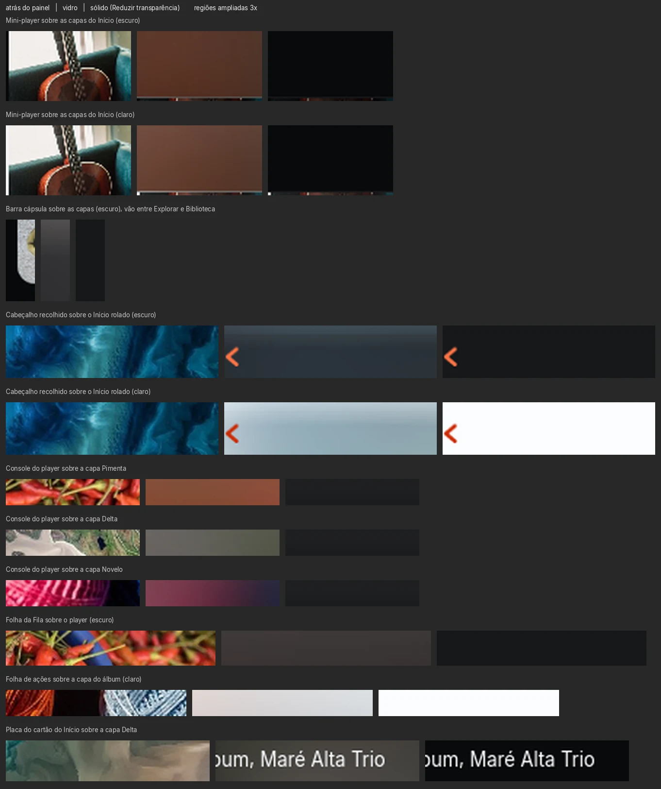

# Prova de vidro no Slint real (v4)

Gerado por `design/v4/tools/glass_proof.py` com o binário `design/v4/tools/slint-shot` (Slint 1.19, renderer FemtoVG, `backdrop-blur` real, via Xvfb/Mesa).
Cada linha compara a mesma região do painel em três renders: como o usuário vê, sem o painel, e com Reduzir transparência.

| Caso | Cena | Vidro x sólido (> 6) | Croma vidro / sólido | Nitidez atrás / no vidro (razão < 0,5) | Cor segue o que está atrás (cosseno > 0,8) e transmissão | |
|---|---|---|---|---|---|---|
| Mini-player sobre as capas do Início (escuro) | `scene=home scroll=520 theme=dark` | 48.4 | 44.9 / 3.4 | 33.92 / 9.10 (0.27) | 1.00, transmissão 0.23 | passa |
| Mini-player sobre as capas do Início (claro) | `scene=home scroll=520 theme=light` | 59.1 | 45.0 / 3.6 | 33.12 / 10.06 (0.30) | 1.00, transmissão 0.27 | passa |
| Barra cápsula sobre as capas (escuro), vão entre Explorar e Biblioteca | `scene=home scroll=240 theme=dark` | 33.1 | 2.0 / 4.0 | 36.03 / 10.06 (0.28) | 0.90, transmissão 0.11 | passa |
| Cabeçalho recolhido sobre o Início rolado (escuro) | `scene=home scroll=160 theme=dark` | 31.3 | 18.2 / 5.5 | 17.34 / 6.77 (0.39) | 0.96, transmissão 0.13 | passa |
| Cabeçalho recolhido sobre o Início rolado (claro) | `scene=home scroll=160 theme=light` | 75.5 | 33.0 / 3.7 | 17.34 / 5.97 (0.34) | 1.00, transmissão 0.39 | passa |
| Console do player sobre a capa Pimenta | `scene=player cover=5` | 58.5 | 78.4 / 3.0 | 42.30 / 5.83 (0.14) | 1.00, transmissão 0.86 | passa |
| Console do player sobre a capa Delta | `scene=player cover=3` | 61.7 | 9.3 / 3.0 | 42.73 / 5.75 (0.13) | 1.00, transmissão 0.63 | passa |
| Console do player sobre a capa Novelo | `scene=player cover=1` | 37.4 | 45.1 / 3.0 | 38.97 / 9.97 (0.26) | 0.98, transmissão 0.77 | passa |
| Folha da Fila sobre o player (escuro) | `scene=player cover=5 theme=dark` | 32.2 | 5.3 / 4.0 | 33.61 / 7.99 (0.24) | 1.00, transmissão 0.11 | passa |
| Folha de ações sobre a capa do álbum (claro) | `scene=album cover=1 theme=light` | 37.4 | 5.2 / 2.0 | 59.67 / 12.33 (0.21) | 1.00, transmissão 0.21 | passa |
| Placa do cartão do Início sobre a capa Delta | `scene=home theme=dark` | 51.3 | 6.3 / 3.0 | não se aplica | não se aplica | passa |

Leitura: no vidro a cor do que está atrás aparece (o cosseno perto de 1 diz que a cor do painel se move na direção da cor de trás) e o detalhe some (nitidez baixa): é desfoque de fundo de verdade. A transmissão é quanto da cor de trás chega ao painel.
No sólido a região é uma cor só: é o que aparece com Reduzir transparência e no renderer software.
