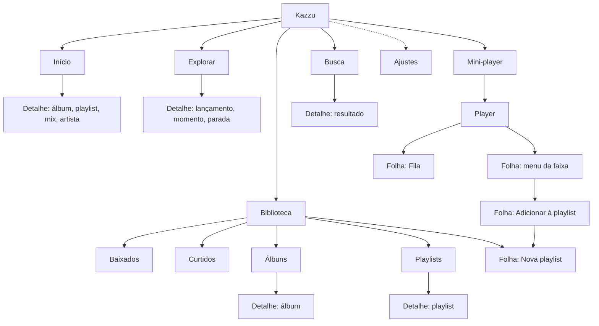

# 03. Arquitetura de informação e navegação

## 1. Inventário: o que o produto faz hoje

Fonte: código em `crates/` e `docs/UI_NOTES.md`. A UX só promete o que existe; o resto é marcado.

| Área | Funciona hoje | Ainda não (aparece como "Em breve" ou fica fora) |
|---|---|---|
| Fontes | YouTube Music sem login (padrão); arquivos locais (FLAC, WAV, Opus, MP3) | Spotify, Tidal, Qobuz |
| Início | Destaques, escolhas rápidas com motivo, mixes, álbuns, recentes locais; cache em disco | Recomendações próprias |
| Explorar | Lançamentos, momentos e gêneros, em alta | |
| Busca | Texto com sugestões, filtro por tipo, melhor resultado, recentes | Reconhecer pelo som |
| Detalhe | Álbum, playlist, artista, coleção, momento; tocar tudo e aleatório; salvar álbum | Baixar |
| Biblioteca | Curtidos, álbuns, playlists locais (com faixas remotas), pastas do aparelho, varredura | Baixados; renomear e apagar playlist |
| Player | Tocar, pausar, pular, buscar posição, aleatório, repetir, volume, curtir, selo de formato | Letras, timer, escolher saída, equalizador |
| Fila | Ver, pular para, remover, mover para cima, limpar; continuar com parecidas | Reordenar arrastando |
| Avisos | Desfazer em curtir e fila; tentar de novo; sem conexão | Desfazer em "adicionar à playlist" |
| Ajustes | Tema, reduzir transparência e movimento, qualidade do streaming, continuar com parecidas, pastas, apagar histórico, relatar problema, licenças | Contas de provedores |
| Sistema | Voltar do Android, áreas seguras | Notificação de mídia, tela de bloqueio |

## 2. Agrupamento (por que três abas e uma busca)

| Conteúdo | Pergunta da pessoa | Destino |
|---|---|---|
| Destaques, escolhas rápidas, mixes, recentes | "O que eu ouço agora?" | **Início** |
| Lançamentos, momentos, gêneros, paradas | "O que existe por aí?" | **Explorar** |
| Baixados, curtidos, álbuns, playlists, pastas | "Cadê as minhas coisas?" | **Biblioteca** |
| Texto digitado, recentes, reconhecer pelo som | "Quero aquela música" | **Busca** (botão próprio) |
| Tema, acessibilidade, qualidade, privacidade | "Quero ajustar o app" | **Ajustes** (engrenagem no topo) |
| Faixa atual, fila | "O que está tocando?" | **Mini-player** e **Player** |

Ajustes não é aba: é uso raro e não merece um quarto do polegar. Busca não é aba comum: é uma ação, e o mapa mental pede um ícone próprio na barra principal.

## 3. Árvore do app



Profundidade máxima a partir de uma aba: 2 telas (lista, depois detalhe). Folhas não contam como telas: fecham e devolvem ao mesmo lugar.

## 4. Nomes

| Rótulo | Por que este | Rejeitados |
|---|---|---|
| Início | Padrão do Android e do iOS em pt-BR | Home, Principal |
| Explorar | Pedido do mapa (barra do Bitchord) | Descobrir, Navegar |
| Biblioteca | Pedido do mapa | Sua música, Coleção |
| Buscar (rótulo do botão e título da tela) | Verbo da ação | Pesquisa, Procurar |
| Curtidos, Baixados, Álbuns, Playlists | Pedido do mapa | Favoritas, Offline |
| Fila | Curto e conhecido | A seguir (vira subtítulo da lista) |
| Ajustes | Curto; padrão do iOS em pt-BR | Configurações (é o que o leitor de tela anuncia como dica) |
| Reconhecer pelo som | Diz o que faz | Shazam (marca), Ouvir ambiente |
| Este aparelho | Nome da saída padrão; a mesma palavra de "Neste aparelho" na Biblioteca | Este celular, Saída simulada, Padrão do sistema |

## 5. Navegação no celular

### 5.1 Estrutura da tela (390 × 844 dp)

```
+--------------------------------+
| barra de status (área segura)  |
| kazzu                  [Ajustes]|  cabeçalho da aba: logo no Início, título grande nas outras
|                                |
|  conteúdo que rola             |  capas e listas passam por trás do que flutua
|                                |
| (capa) Título      [Pausar][>>]|  mini-player (60), só quando há faixa
|                                |
| (Início Explorar Biblioteca)(B)|  barra cápsula (64) + busca redonda (64), B = Buscar
| área segura inferior           |
+--------------------------------+
```

(O desenho acima é só um esquema de posições. As telas de verdade estão nos protótipos e nos renders.)

| Elemento | Medida | Regra |
|---|---|---|
| Margem lateral | 20 dp (16 em 360) | Igual dos dois lados |
| Cabeçalho da aba | 48 de linha + área segura | Logo no canto superior esquerdo em todas as abas, Ajustes à direita. Explorar, Biblioteca e Buscar têm o título grande de 34 logo abaixo; no Início o logo é o título |
| Cabeçalho recolhido | 48 + área segura, vidro | Aparece quando o título grande sai da tela; título de 17 centralizado (no Início, a marca K à esquerda) |
| Barra cápsula | 64 de altura; alvos de 56 × largura da aba | 12 acima da área segura inferior; 16 das laterais |
| Busca | círculo de 64 | 8 à direita da cápsula, mesma linha |
| Mini-player | 60 de altura, largura total menos 32 | 8 acima da cápsula; some quando não há faixa |
| Reserva de rolagem | 160 + área segura (88 sem faixa) | O último item sempre rola para cima do cromo |

### 5.2 Zona do polegar

Tudo o que se usa a cada minuto fica no terço inferior: trocar de aba, buscar, pausar, pular, abrir o player. O topo fica com o que é raro (Ajustes) e com o que é só leitura (logo, título). No player, transporte e volume ficam na metade inferior; fechar tem botão no topo e o gesto de arrastar em qualquer ponto da capa.

### 5.3 Regras de navegação

1. **Abas guardam o estado.** Voltar a uma aba mostra a rolagem e o detalhe onde ficaram.
2. **Tocar na aba ativa** volta para a raiz dela; tocar de novo rola para o topo.
3. **Busca**: o primeiro toque abre a tela com o campo em foco e o teclado; com a Busca aberta, tocar no botão de novo limpa o texto e refoca. Sair da Busca volta para a aba de onde veio.
4. **Detalhe** abre por cima da aba e mantém o mini-player e a barra visíveis.
5. **Player** cobre tudo, inclusive a barra. Fila e menu são folhas por cima do player.
6. **Uma camada por vez**: abrir a Fila fecha o menu, e vice-versa.

### 5.4 Ordem do Voltar (Android, Esc no desktop)

| Situação | Voltar faz |
|---|---|
| Folha aberta (menu, playlist, nova playlist) | Fecha a folha |
| Fila aberta | Fecha a fila (o player continua) |
| Player aberto | Recolhe para o mini-player |
| Busca com texto | Limpa o texto |
| Busca sem texto | Volta para a aba anterior |
| Detalhe aberto | Fecha o detalhe |
| Raiz de Explorar ou Biblioteca | Vai para o Início |
| Raiz do Início | Sai do app (a música continua quando houver serviço em segundo plano) |

Voltar nunca fecha o app com uma camada aberta.

## 6. O que mudou em relação à v2/v3 (e por quê)

| Antes | Agora | Motivo |
|---|---|---|
| Logo + título "Início" + banner + chips | Só o logo e a engrenagem | D4: conteúdo primeiro |
| Logo só no Início | Logo no canto superior esquerdo de todas as abas | Pedido do mapa; a linha já existia por causa de Ajustes |
| Chips "Para você, Descobrir, Mixes, Foco, Treino" no Início | Removidos; momentos ficam em Explorar | D9 e duplicação |
| Busca com duas fileiras de chips | Um controle segmentado de tipo, só com resultados | D9 |
| Player com cápsula e quatro botões-ladrilho | Capa inteira de ponta a ponta, o reflexo dela e um console de vidro; saída atual e Fila em dois botões; Letra e Timer no menu enquanto não existem | D5 |
| Mini-player neutro | Mini-player tingido pela capa da faixa atual | No escuro, vidro sobre fundo preto não mostra nada; a capa dá cor a ele sempre |
| Ladrilhos de momento coloridos | Ladrilhos neutros | Regra da v4: cor só de capa |
| Cartões com moldura na Biblioteca | Arte como ladrilho, texto embaixo | D7 |
| Acento tirado da capa (opção) | Acento fixo da marca; a capa colore só o fundo do player | Menos estados, cor previsível, contraste garantido |
