# 04. Fluxos ponta a ponta

Cada fluxo lista o caminho feliz, os desvios e o critério de aceite ligado a ele (ver `07`). Os diagramas usam Mermaid.

## F1. Primeiro uso: abrir e tocar

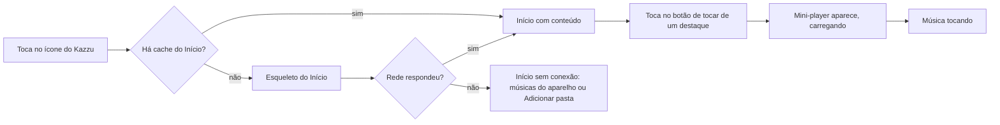

- Sem tela de boas-vindas, sem conta, sem permissão pedida na abertura.
- Uma linha discreta sob o cabeçalho, só na primeira abertura: "O YouTube Music já está ligado. Sem conta." com o botão de dispensar.
- Aceite: AC-01 (2 toques até tocar), AC-06 (rede só na carga inicial).

## F2. Buscar e tocar

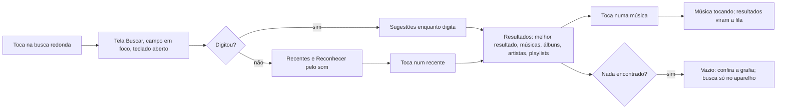

- O filtro por tipo (Tudo, Músicas, Álbuns, Artistas, Playlists) aparece só quando há resultados.
- Erro de rede: mantém o texto, mostra "Não deu para buscar agora" e "Tentar de novo". Sem conexão: busca só no aparelho e diz isso.
- Aceite: AC-02 (3 toques fora a digitação).

## F3. Do mini-player ao player e de volta

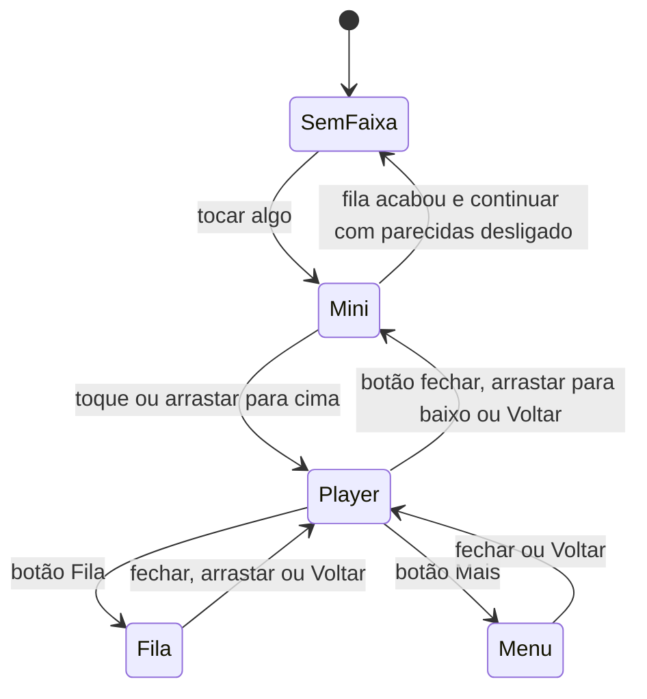

- O mini-player mostra capa, título, artista, tocar/pausar e próxima. A barra de progresso é a borda inferior dele.
- No player: buscar posição arrastando ou tocando na barra; alternativa por teclado e leitor de tela com passos de 10 s.
- Aceite: AC-08 (Voltar fecha sempre a camada de cima).

## F4. Fila

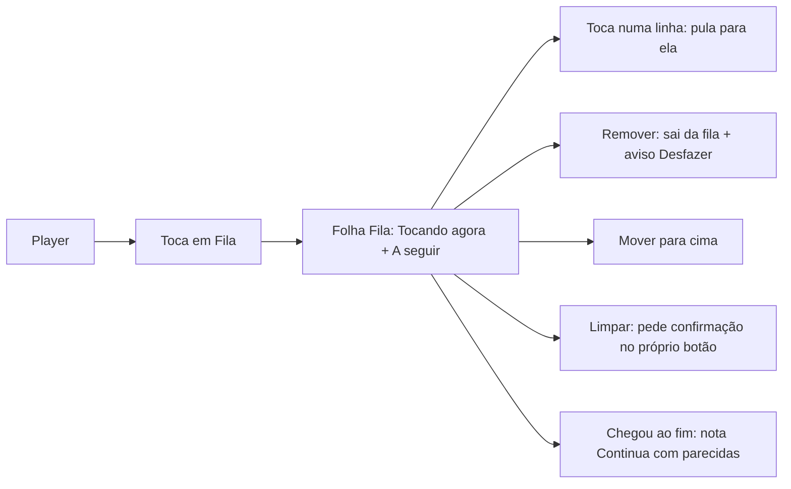

- Reordenar arrastando depende de `PlaybackCommand::Move` (lacuna no `kazzu-audio`); até lá, "Mover para cima" é a alternativa e continua existindo depois, para quem não arrasta.
- Aceite: AC-09 (estados), AC-13 (ações destrutivas têm Desfazer ou confirmação).

## F5. Curtir

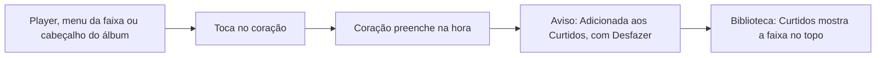

- Atualização otimista: a UI muda na hora; se gravar falhar, volta e avisa.
- Curtidas ficam no aparelho. Não há conta.

## F6. Criar playlist e adicionar faixa

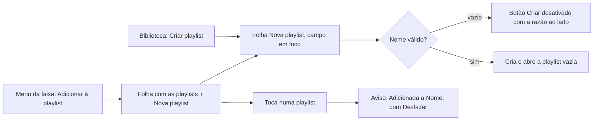

- Playlist vazia explica o próximo passo: "Toque em Mais numa música e escolha Adicionar à playlist".

## F7. Música do aparelho

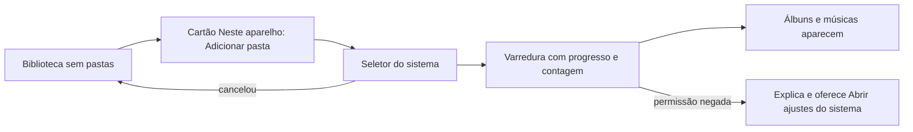

- A permissão é pedida só aqui, quando a pessoa pede o recurso, com uma frase antes do diálogo do sistema.

## F8. Sem conexão e volta da conexão

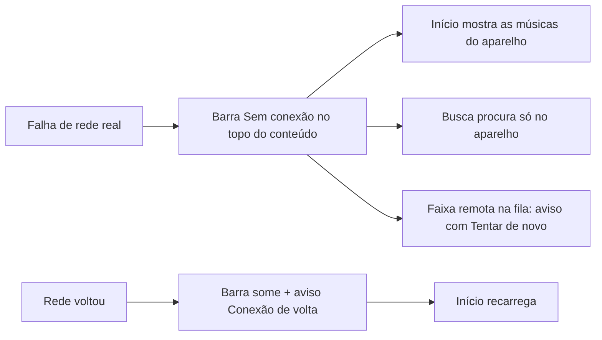

- Não há sondagem de rede em segundo plano: o app descobre que voltou quando a pessoa tenta algo ou quando a faixa seguinte resolve.

## F9. Erro do provedor

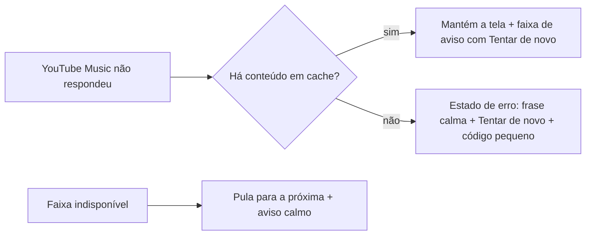

## F10. Ajustar transparência e movimento

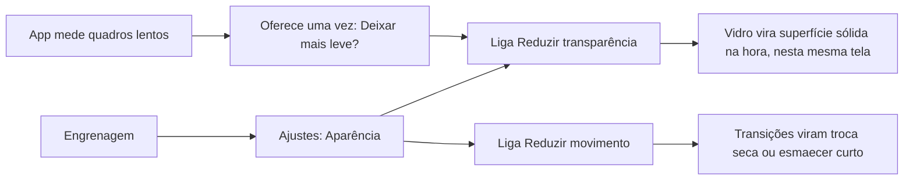

## F11. Reconhecer pelo som (futuro, desenhado para não mudar a navegação depois)

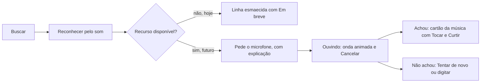
